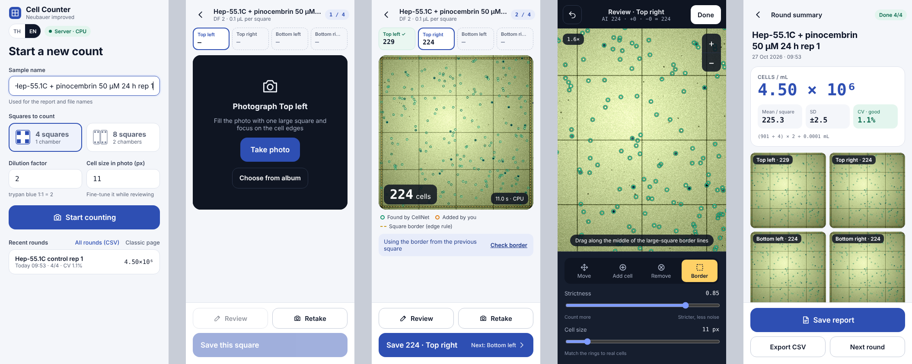

# Cell Counter

Count cells on a Neubauer-improved hemocytometer from a phone photo. Photograph each corner large square through the microscope eyepiece, let **CellNet** (a small neural network) mark the cells, fix any mistakes with a tap, and get cells/mL with a report image you can paste into a lab notebook.



- **Phone-first app** in Thai or English: start a round, count square by square, review, summary.
- **CellNet runs on your own computer.** Photos never leave it. Apple-silicon Macs use the GPU through MLX; any other machine uses NumPy on the CPU.
- **Edge rule built in.** Draw the large-square border once. Cells touching the top/left lines count; cells touching the bottom/right lines don't. The border carries over to the next square.
- **Review tools:** add or remove cells, undo, pinch to zoom, and a strictness slider that updates the count instantly.
- **4 or 8 squares per round** (1 or 2 chambers), with mean ± SD, CV, per-chamber means and cells/mL.
- **Reports:** a PNG with every square's image, a per-square table (found by the model / added / removed) and the method line. Every round is also appended to one `runs.csv`.
- **Training data:** squares you have corrected can be saved as training data for a better model.
- **Lab log:** record hand counts (works offline), sub-passages with pipetting volumes, and treatments with stock-volume calculations, a plate map and a harvest timer. See [Lab log](#lab-log).

> **Accuracy:** the bundled model (CellNet v0.3) was trained on simulated hemocytometer images plus a small set of hand-corrected squares. Before relying on it, count a few squares by hand and compare. Retrain it on your own corrected photos for best results (see [training/](training/)). This is a research tool, not a medical device.

## Run it on your computer

You need **Python 3.9 or newer**. Nothing else is required; the start script installs `numpy` and `pillow` into a private folder (`server/.venv`) the first time.

```bash
git clone https://github.com/deweyyyyy/cell-counter.git
cd cell-counter/server
./start.sh            # macOS / Linux
start.bat             # Windows
```

When you see `ready on http://127.0.0.1:8000`, open **http://localhost:8000** in a browser on the same computer.

On startup the server times the CPU and GPU paths and keeps the faster one; the line starting with `engine:` shows the choice.

### Keep it running on a Mac (optional)

```bash
./install-service.sh            # start at login, restart if it stops, keep the Mac awake while serving
./install-service.sh --remove   # undo
```

Output goes to `server/server.log`.

### Use it from your phone

The phone and the computer must be on the same network:

```bash
./start.sh --lan
```

The server prints an address like `http://192.168.1.23:8000`. Open it on your phone and use **Take photo** to shoot through the eyepiece.

`--lan` has no login: anyone on that network can open the page. Only use it on a network you trust.

### Share it with your lab securely (optional)

To reach the app from anywhere with a login, put it behind a tunnel instead of using `--lan`. One way is [Cloudflare Tunnel](https://developers.cloudflare.com/cloudflare-one/connections/connect-networks/) plus [Cloudflare Access](https://developers.cloudflare.com/cloudflare-one/policies/access/):

1. Run the server normally (`./start.sh`, which listens on `127.0.0.1` only).
2. Create a tunnel whose public hostname points to `http://localhost:8000`.
3. Add an Access application for that hostname, allowing only your lab's emails.

The server reads the `Cf-Access-Authenticated-User-Email` header and records who counted each round and who sent training data.

## How to count a round

1. **Start:** name the sample, choose 4 or 8 squares, and set the dilution factor (2 for trypan blue 1:1) and the approximate cell diameter in pixels.
2. **Count a square:** take a photo with one large square filling the frame. CellNet counts it in about a second.
3. **Set the border** the first time (Review → Border): drag along the middle of the large square's border lines. The border is reused for the next squares, and you can check it from the banner.
4. **Review** if needed: add or remove cells, adjust strictness, then **Done**.
5. **Save the square**, and the app moves to the next one. After the last square you land on the summary.
6. **Save report** stores the report on the server and downloads a copy to the phone.

Concentration is calculated as `cells/mL = mean cells per square × dilution factor ÷ 0.0001 mL` (one large square holds 0.1 µL).

The classic single-page version of the app is still available at `/old`. It includes a simulated sample image with known answers, which is handy for checking the model.

## Lab log

The home screen also keeps a simple culture log:

- **Hand count:** type the cells you counted in each square from the lab counter. The app gives mean ± SD, CV and cells/mL. It works with no internet; entries are kept on the phone and sent when the connection comes back.
- **Passage:** pick a count (camera or hand), then list the new vessels (6/12/24/96-well plates, 35/60/100 mm dishes, T25/T75/T175 flasks) with the cells and medium you want in each well, dish or flask. The app shows how many µL of cell suspension and mL of medium to pipette into each one.
- **Treat:** keep a list of compounds with their stock concentration and solvent (add your own). Build groups (glucose, one or more compounds at µM), and the app works out the stock volume per group, adds vehicle so every group ends at the same DMSO/EtOH %, draws the plate map and sets a harvest timer that shows on the home screen.
- **Protein harvest:** pick the experiment and the app lists one tube per group (or per well) with lysis buffer volume, storage temperature and box position. Add BCA concentrations to the tubes later from the log.
- **Notes and photos:** write a note and attach photos (taken with the camera or chosen from the phone), optionally linked to an experiment or a culture. Photos are resized to 2000 px and kept on the phone until they reach the server, so this works offline too.
- **In the incubator:** the home screen lists every plate, dish and flask still growing, with its passage, days in culture and, for plates under treatment, a plate map (columns 1–3, rows A–B for a 6-well plate).
- **Checklists and steps:** passage, treatment, protein harvest and counting each show a tick-off list of what to prepare and the steps. Ticks reset every day; edit the list in the app and the new version is saved to the log.
- **Several people, one log:** pick your name on the home screen and new entries are recorded under it. Each vessel in a passage can belong to someone, and the log can be filtered by person. Edit the `PEOPLE` list in `app.html` for your lab.
- **Log:** everything by date, with filters, delete, and CSV export. Tap an entry to see all its details: plate map, groups, preparation, tubes, lysis mix, steps, photos and related entries.

The log is stored on the server in `lab/events.jsonl`, one JSON entry per line; photos go to `lab/photos/`.

## Where your data goes

Everything stays inside `server/`:

| Path | Contents |
|---|---|
| `reports/<date>_<name>/` | `report.png`, each square's annotated image (`tl.jpg`, …) and `run.json` |
| `reports/runs.csv` | one row per round: every square's count, mean, SD, CV, chamber means, cells/mL |
| `training_data/` | corrected squares sent with **Send as CellNet training data** |
| `lab/events.jsonl` | the lab log: counts, passages, treatments, protein harvests, notes |
| `lab/photos/` | photos attached to notes |

These folders are ignored by git.

## Improve the model

[training/](training/) contains the simulated-image generator, the training script and the exporter. Train on your corrected squares plus simulated data, export to `cellnet_w.json`, drop it into `server/` and restart. The page shows which model version is running.

## How it works

- `server/app.html`: the phone app (plain HTML/JS, no build step).
- `server/server.py`: a standard-library HTTP server. `POST /api/count` takes the cropped square, rescales it so cells are about 13 px across, runs CellNet and returns candidate centres with confidence scores. The page applies the strictness threshold, de-duplication and the edge rule, so moving the slider needs no new request.
- `server/cellnet_np.py`: CellNet inference in NumPy, plus an MLX path for Apple GPUs. The model is a ~118k-parameter U-Net that outputs a heatmap of cell centres.
- `server/cellnet_w.json`: the weights (≈ 470 KB).

## License

MIT. See [LICENSE](LICENSE).
